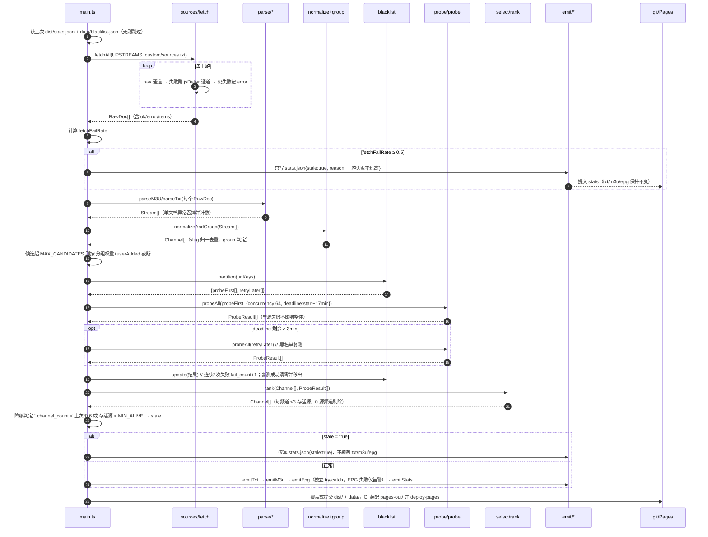

# 系统架构设计 + 任务分解：IPTV 源聚合工具

> 输入：`docs/PRD.md`（v1）。版本 `design-v1`。工程师按 §7 顺序实现，按 §8 共享约定写代码。

## 1. 实现方案与框架选型

### 1.1 技术栈决策

| 层 | 决策 | 理由 |
|---|---|---|
| Actions 构建端 | **Node.js 20 + TypeScript，用 `tsx` 直接执行源码，不产出编译产物** | Node 20 自带 `fetch`(undici)、`AbortSignal.timeout`、`fs/promises`，无需 axios/node-fetch。`tsx` 一个 devDep 即可直跑 `.ts`，`npm ci` 后启动 <1.5s，无 tsc 构建步骤 → Actions 省时间、无 sourcemap 坑；vitest 同一套配置直接跑 `.ts` 单测 |
| 依赖策略 | **Node 端第三方运行时依赖 = 0**（除 `typescript/tsx/vitest/@types`） | m3u/txt 解析、并发池、时间格式化、HTTP 全部手写，单文件 20~80 行，避免包体积与供应链风险；解析规则需与频道归一强耦合，引包反而受限 |
| 网页端 | Vite 5 + React 18 + MUI 5 + Tailwind 3 + HashRouter | 纯静态；Hash 路由规避 Pages 深链 404；`base: './'` 免配置 fork 子路径 |
| 发布 | Actions 组装 `pages-out/` → `actions/deploy-pages`；数据产物同时提交到 `dist/` | 见 §1.2 |

### 1.2 关键坑位：`dist/` 目录冲突（必须按此执行）

**方案：数据产物与网页产物彻底分家，只有数据入库。**

| 目录 | 内容 | 是否提交 git | 谁生成 |
|---|---|---|---|
| `src/` `web/` `tests/` | 源码 | ✅ 提交 | 人 |
| `dist/txt/all.txt`、`dist/m3u/all.m3u`、`dist/epg/epg.xml`、`dist/stats.json` | **唯一数据产物目录** | ✅ 提交（覆盖式，1 个 commit/次） | `npm run build` |
| `data/blacklist.json`、`data/history.json` | 状态记忆 | ✅ 提交 | `npm run build` |
| `site/` | Vite 构建输出（网页） | ❌ gitignore | `npm run build:web` |
| `pages-out/` | Pages 站点装配目录 = `site/**` + `dist/{txt,m3u,epg,stats.json}` 平铺拷贝（`tex→pages-out` 内为 `txt/`、`m3u/`、`epg/`、`stats.json`） | ❌ gitignore | `node scripts/assemble-pages.mjs` |

- `vite.config.ts`：`root: 'web'`，`build.outDir: '../site'`，`emptyOutDir: true`（只清 `site/`，永不触碰 `dist/`）。
- 三套链接（首页 `lib/links.ts` 生成）：
  - Pages：`https://<owner>.github.io/<repo>/txt/all.txt`
  - raw：`https://raw.githubusercontent.com/<owner>/<repo>/main/dist/txt/all.txt`
  - jsDelivr：`https://cdn.jsdelivr.net/gh/<owner>/<repo>@main/dist/txt/all.txt`

### 1.3 五层分层（单向前序，可独立降级）

| 层 | 入口 | 输入 | 输出 | 失败降级 |
|---|---|---|---|---|
| L1 抓取 | `sources/fetch.ts` | `UPSTREAMS[]` + `custom/sources.txt` | `RawDoc[] {origin, text, ok, error}` | 单源失败跳过；全失败 → 进入 stale 分支 |
| L2 解析 | `parse/parseM3U.ts` `parseTxt.ts` | `RawDoc.text` | `Stream[]`（未归一） | 单文档解析异常吞掉并计数 |
| L3 归一 | `normalize/channelName.ts` `group.ts` | `Stream[]` | `Channel[]`（含 slug/group/去重后 streams） | 命中不了规则的归"其他" |
| L4 测活 | `probe/probe.ts` | `Channel[].streams`（先过黑名单） | `Map<urlKey, ProbeResult>` | 单源失败记 dead；全局 deadline 到点 → 剩余记 `unknown`（不输出） |
| L5 优选+生成 | `select/rank.ts` + `emit/*` | `Channel[]` + `ProbeResult[]` | `dist/**`、`data/blacklist.json`、`data/history.json` | EPG 失败只跳过 EPG；txt/m3u 生成失败 → 不覆盖旧文件并 stale |

### 1.4 浏览器端测活（**CORS 明确可行方案，无服务器**）

真实约束：绝大多数 IPTV 源不返回 `Access-Control-Allow-Origin`，`fetch` 读不到状态码与内容。因此采用**三级探测阶梯**，并在 UI 上如实标注置信度：

| 级 | 手段 | 能拿到 | verdict | 置信度 |
|---|---|---|---|---|
| L1 | `fetch(url, {headers:{Range:'bytes=0-2047'}, signal})`，CORS 成功 | HTTP 状态、`content-type`、m3u8 文本 → 解析 `#EXT-X-STREAM-INF` 的 `RESOLUTION/BANDWIDTH`，再补拉首片 `Range: bytes=0-1023` | `alive` | 高 |
| L2 | L1 抛 `TypeError` → 立刻用 `fetch(url, {mode:'no-cors', cache:'no-store', signal})` + `?__t=<ts>` 去缓存；成功 = TCP/TLS/HTTP 已到达；并行读 `performance.getEntriesByName(url)` 取 `duration`/`responseStart` 当延迟 | 可达性 + 延迟 | `reachable`（UI 文案"可达·浏览器受限"） | 低 |
| L3 | L2 也 reject：`<timeout>` → `timeout`；其他 → `dead` | — | `dead`/`timeout` | 高 |

补充规则（写进 `probeClient.ts`）：

- 明确声明局限：`no-cors` 为 opaque 响应，**无法区分 200 与 404/403**，所以 `reachable` ≠ 能播；UI 用黄色 ⚠️ 并在表格副标题写"浏览器无法读取跨域源内容，精确结果以 Actions 构建为准"。
- **不做** `<video>` 元素探测：非 Safari 浏览器无原生 HLS，`loadedmetadata` 永远不触发，会误判全挂。
- 并发用自研 worker pool，默认 8（浏览器对同 host 限 6 连接，64 会自己排队且更慢）；每源 `AbortSignal.timeout(8000)`；`document.hidden` 时暂停派发。
- 高级设置里提供**可选**"自定义前缀"输入框（用户自己填的 URL 前缀，默认空且关闭），用于极少数自建代理场景；产品默认路径不依赖任何服务器。

### 1.5 25 分钟预算设计

| 控制点 | 值 | 说明 |
|---|---|---|
| 候选源上限 `MAX_CANDIDATES` | 3000（按分组优先级+上游顺序截断） | 超出部分不测 |
| 并发 `PROBE_CONCURRENCY` | 64 | 3000 全超时最坏 3000/64×8s ≈ 6.3min，含 HLS 二跳 ≈ 12min |
| 单源超时 `PROBE_TIMEOUT_MS` | 8000（首跳）/ 4000（子请求） | |
| 全局 deadline | `probeStart + 17min` | 超时后剩余源 `skipped`，不阻塞出产物 |
| workflow | `timeout-minutes: 25`，job 内先写 `dist/` 再发布 | 保证超时也已有产物 |
| 黑名单复测 | deadline 剩余 >3min 才跑第二轮回测 | 保证可恢复 |

---

## 2. 文件清单

```
iptv/
├─ package.json                      # scripts: build / build:web / test / validate:local / pages:assemble
├─ tsconfig.json                     # strict, module=ESNext, target=ES2022, noEmit
├─ vite.config.ts                    # root=web, outDir=../site, base='./'
├─ tailwind.config.js                # content 扫 web/**，preflight:false（避免与 MUI 冲突）
├─ postcss.config.js
├─ .gitignore                        # site/ pages-out/ node_modules/ *.log
├─ .nvmrc                            # 20
├─ README.md                         # 非技术用户教程：Fork→开 Pages→Token→粘贴电视
├─ custom/sources.txt                # 用户自填行（P2 预留，初始仅注释）
├─ data/blacklist.json               # {version:1, entries:{urlKey:{fail_count,last_checked}}}
├─ data/history.json                 # 最近 7 次构建摘要（P1-4）
├─ docs/system_design.md             # 本文
├─ docs/sequence-diagram.mermaid
├─ docs/class-diagram.mermaid
├─ scripts/assemble-pages.mjs        # 装配 pages-out/（site + dist 数据平铺）
├─ .github/workflows/update.yml      # cron 0 */6 * * * + workflow_dispatch + Pages 部署 + 提交 dist
├─ src/
│  ├─ main.ts                        # 编排 + 降级判定 + 落盘（唯一入口，try/catch 兜底不抛非零退出除非真崩）
│  ├─ types.ts                       # §3 全部 interface/type
│  ├─ config.ts                      # UPSTREAMS / 并发 / 超时 / 阈值 / 分组权重 / 路径常量
│  ├─ data/
│  │  ├─ channel-rules.ts            # 频道名归一规则表 + 港澳台/广东关键词 + epg 别名表
│  │  └─ groups.ts                   # GROUP_ORDER 与权重常量
│  ├─ sources/fetch.ts               # 多上游抓取，raw + jsDelivr 双通道兜底
│  ├─ parse/parseM3U.ts              # #EXTINF 解析（tvg-id/tvg-name/tvg-logo/group-title）
│  ├─ parse/parseTxt.ts              # DIYP txt 解析（#genre# 分组头 + 逗号 + # 分隔）
│  ├─ normalize/channelName.ts       # 归一为 {slug, name, group}，缓存别名命中
│  ├─ normalize/group.ts             # 分组判定 + 组内排序键
│  ├─ probe/probe.ts                 # probeOne / probeAll（并发池 + deadline）
│  ├─ probe/hls.ts                   # m3u8 解析（master→variant→首片）、content-type 判定
│  ├─ select/rank.ts                 # 去重 + 每频道优选 3 源 + 评分
│  ├─ emit/txt.ts                    # dist/txt/all.txt（UTF-8 无 BOM，LF）
│  ├─ emit/m3u.ts                    # dist/m3u/all.m3u
│  ├─ emit/epg.ts                    # dist/epg/epg.xml（XMLTV，+0800，失败仅跳过）
│  ├─ emit/stats.ts                  # dist/stats.json + data/history.json
│  ├─ blacklist.ts                   # 读写 + 连续 2 次失败入黑 + 复测成功恢复
│  └─ util/{http.ts,pool.ts,time.ts,log.ts}   # fetch 封装(重试/超时) / worker 池 / +0800 格式化 / 结构化日志
├─ web/
│  ├─ index.html
│  └─ src/
│     ├─ main.tsx                    # ThemeProvider + CssBaseline + HashRouter
│     ├─ App.tsx                     # 顶部导航 + <Outlet/> + 免责声明页脚
│     ├─ theme.ts                    # MUI 主题（中文兜底字体、tv-friendly 大字号）
│     ├─ components/{CopyField.tsx, StatCards.tsx, StatusChip.tsx, GuideSteps.tsx}
│     ├─ pages/Home.tsx              # 状态看板 + 三种链接 + 分步教程 + 分组概况 + stale 黄条
│     ├─ pages/Tester.tsx            # 粘贴/上传 → 检测 → 排序筛选表格 → 复制可用源/导出 txt
│     ├─ pages/Update.tsx            # Token 存取 + 触发 dispatch + 10s 轮询 + 中文错误映射
│     └─ lib/
│        ├─ probeClient.ts           # §1.4 三级阶梯实现 + 并发池 + 进度回调
│        ├─ githubApi.ts             # resolveRepo / verifyToken / dispatchWorkflow / getLatestRun / getRunJobs
│        └─ links.ts                 # 三套链接 URL 生成 + stats.json 读取
└─ tests/
   ├─ parse.test.ts                  # m3u / txt 解析（含畸形输入）
   ├─ normalize.test.ts              # CCTV1/CCTV-1/中央1台 归一、港澳台/广东识别
   ├─ rank.test.ts                   # 分辨率降序→延迟升序、不足 3 源、0 源不输出
   ├─ probe.test.ts                  # 注入 mock fetch，验证 200/404/超时/m3u8 二跳
   └─ fixtures/{sample.m3u,sample.txt,upstream-*.ts}   # 离线 fixture
```

---

## 3. 数据结构与接口（TS 定义，可直接落地）

```ts
// src/types.ts
export type GroupKey = '港澳台' | '广东' | '央视' | '卫视' | '其他';
export type StreamKind = 'hls' | 'flv' | 'ts' | 'mp4' | 'other';

export interface Stream {
  url: string;            // 原始 URL（保留原样输出给播放器）
  urlKey: string;         // 去重键：scheme+host(小写)+path+query 规范化，去掉末尾 '/'
  rawName: string;        // 上游原始频道名
  channelId: string;      // 归一后 slug，如 'cctv1' | 'tvb-jade' | 'gd-zhujiang'
  group: GroupKey;
  logo?: string;
  origin: string;         // 'iptv-org-cn' | 'custom' | ...
  userAdded?: boolean;    // custom/sources.txt 来的，优先级最高
}

export interface Channel {
  id: string;             // === channelId（唯一标识，ASCII slug）
  name: string;           // 标准中文名，如 'CCTV-1 综合'
  aliases: string[];      // 命中过的原始写法
  group: GroupKey;
  logo?: string;
  epgId?: string;         // 上游 XMLTV 的 channel id，用于 EPG 匹配
  streams: Stream[];
}

export type ProbeStatus = 'alive' | 'dead' | 'timeout' | 'skipped' | 'unknown';

export interface ProbeResult {
  urlKey: string;
  status: ProbeStatus;
  alive: boolean;         // status === 'alive'
  httpStatus?: number;
  latencyMs?: number;     // 首字节耗时
  contentType?: string;
  kind?: StreamKind;
  width?: number; height?: number;
  resolution?: string;    // '1920x1080'（来自 EXT-X-STREAM-INF 或 content 嗅探）
  bandwidth?: number;     // bps
  error?: string;
  checkedAt: string;      // ISO 8601 +08:00
}

export interface UpstreamStat { name: string; ok: boolean; items: number; channel: 'raw' | 'jsdelivr' | 'custom'; error?: string }

export interface BuildStats {
  version: 1;
  updated_at: string;          // '2025-01-01T12:00:00+08:00'
  channel_count: number;
  source_count: number;        // 输出的源条数
  groups: Record<GroupKey, number>;
  upstream: UpstreamStat[];
  fetch_fail_rate: number;     // 0~1
  probe: { total: number; alive: number; dead: number; timeout: number; skipped: number; duration_ms: number };
  epg: { ok: boolean; programmes: number; error?: string };
  build_duration_ms: number;
  stale: boolean;
  stale_reason?: string;
}

export interface BlacklistEntry { fail_count: number; last_checked: string }
export interface BlacklistFile { version: 1; entries: Record<string, BlacklistEntry> }
export interface HistoryFile { version: 1; items: Array<Pick<BuildStats,'updated_at'|'channel_count'|'source_count'|'stale'>> }

// 依赖注入点（单测离线跑的关键）
export interface ProbeDeps { fetchImpl?: typeof fetch; now?: () => number }
export function probeOne(url: string, opts?: { timeoutMs?: number; signal?: AbortSignal }, deps?: ProbeDeps): Promise<ProbeResult>;
export function probeAll(targets: Array<{urlKey: string; url: string}>, opts: { concurrency: number; timeoutMs: number; deadline: number }, deps?: ProbeDeps): Promise<ProbeResult[]>;
```

**存活判定标准（`probeOne`，可实现版）**

1. `GET url`，`headers: { Range: 'bytes=0-65535', 'User-Agent': 'IPTVHub/1.0' }`，`redirect:'follow'`，`signal: AbortSignal.timeout(8000)`。
2. 非 `http/https`（rtmp/rtsp/udp/p3p）→ `status:'skipped'`（播放器可能能播，但我们不测、不输出）。
3. 最终状态非 2xx/3xx → `dead`。
4. `content-type` 含 `mpegurl|m3u` 或 body 前 64 字节是 `#EXTM3U` → 视为 HLS：master 则取 `BANDWIDTH` 最高变体地址，media 则取第一个非注释 URI；对目标地址再来一次 `Range: bytes=0-2047`。
5. 拿到首片/首分片：状态 2xx 且 `byteLength >= 188`（TS 包长）或 `>0` 且 content-type 属 `video|octet-stream|mp2t` → `alive`；否则 `dead`。
6. `AbortError` → `timeout`；其他异常 → `dead` 且写 `error`。
7. 打分（仅 rank 内部用，不落盘）：`score = (width>=1920?3:width>=1280?2:width>=854?1:0)*1e6 + (10000 - min(latencyMs,10000))`。

---

## 4. 调用时序（完整版见 `docs/sequence-diagram.mermaid`）



---

## 5. 依赖包清单

**Node 端（devDependencies，运行时零依赖）**

| 包 | 版本 | 用途 |
|---|---|---|
| typescript | ^5.6.3 | 类型检查 `npm run typecheck` |
| tsx | ^4.19.2 | 直接执行 `src/main.ts`，无构建步骤 |
| vitest | ^2.1.8 | 单测（原生 ESM + TS） |
| @types/node | ^20.17.0 | Node 20 类型 |

**网页端（dependencies）**

| 包 | 版本 | 用途 |
|---|---|---|
| react / react-dom | ^18.3.1 | UI |
| react-router-dom | ^6.28.0 | `HashRouter` 三个页面 |
| @mui/material | ^5.16.7 | 组件库 |
| @emotion/react / @emotion/styled | ^11.13.0 | MUI 样式引擎 |
| @mui/icons-material | ^5.16.7 | 状态图标 |

**网页端（devDependencies）**：`vite ^5.4.11`、`@vitejs/plugin-react ^4.3.4`、`tailwindcss ^3.4.17`、`postcss ^8.4.49`、`autoprefixer ^10.4.20`

> Tailwind 必须 `corePlugins: { preflight: false }`，否则重置样式会打坏 MUI。

---

## 6. 待明确事项（≤5，均给默认值，不阻塞开工）

| # | 事项 | 默认执行 |
|---|---|---|
| 1 | 上游清单最终名单（PRD 只写"≥3 个"） | 默认 5 个：`iptv-org/iptv`(cn.m3u)、`iptv-org/iptv`(index 分类)、`fanmingming/live`、`vbskycn/iptv`、`Free-TV/IPTV`；全部走 raw+jsDelivr，配置在 `config.ts` 便于增删 |
| 2 | 源不含频道名（纯 URL 行）时归哪个频道 | 丢弃（无法归类），计入 `stats.probe.skipped`，不猜 |
| 3 | EPG 公开源稳定性 | 默认引用 1~2 个公开 XMLTV，失败则输出"仅 `<channel>` 无节目"的最小合法 XMLTV；全失败才置 `epg.ok=false` |
| 4 | 仓库 owner/repo 在网页端如何得知 | 由 `location.hostname`+`pathname[0]` 推断（`*.github.io/<repo>/`），自定义域名时在 `/update` 高级设置手填覆盖 |
| 5 | `lite.txt`(P2-2) 是否本期做 | 本期不做，但 `emit/txt.ts` 导出 `renderTxt(channels, filter?)` 预留过滤参数 |

---

## 7. 有序任务列表

> 并行提示：`T03~T06` 可 4 人/4 线并行；`T12` 与 `T03~T11` 完全并行；`T13/T14/T15` 在 `T12` 后三线并行。

| # | 任务 | 产出文件 | 依赖 | 验收标准 |
|---|---|---|---|---|
| T01 | 项目基础设施 | `package.json` `tsconfig.json` `vite.config.ts` `tailwind.config.js` `postcss.config.js` `.gitignore` `.nvmrc` `custom/sources.txt` | — | `npm i` 成功；`npm run typecheck` 零错误；`npm run build:web` 输出到 `site/` 且 `dist/` 未被清空 |
| T02 | 类型 + 配置 + 规则表 | `src/types.ts` `src/config.ts` `src/data/groups.ts` `src/data/channel-rules.ts` | T01 | 类型与 §3 完全一致；`GROUP_ORDER = ['港澳台','广东','央视','卫视','其他']`；规则表 ≥60 条（CCTV1-17、卫视 30+、港澳台 20+、广东 21 地市） |
| T03 | 抓取层 + 工具 | `src/sources/fetch.ts` `src/util/http.ts` `src/util/pool.ts` `src/util/time.ts` `src/util/log.ts` | T02 | raw 失败自动切 jsDelivr；单上游异常不外抛；`formatCST()` 在 `TZ=UTC` 下输出 `+08:00` 正确 |
| T04 | 解析层 | `src/parse/parseM3U.ts` `src/parse/parseTxt.ts` `tests/parse.test.ts` `tests/fixtures/{sample.m3u,sample.txt}` | T02 | 覆盖 `#EXTINF` 带/不带属性、`tvg-logo` 缺失、txt `#genre#` 分组、`url1#url2#url3` 拆行、BOM/CRLF 输入；单测全绿 |
| T05 | 归一 + 分组 | `src/normalize/channelName.ts` `src/normalize/group.ts` `tests/normalize.test.ts` | T02 | `CCTV1/CCTV-1/中央1台/央视一套` → 同一 slug `cctv1`；`翡翠台/TVB翡翠` → 港澳台；`广东珠江/珠江频道` → 广东；未知 → 其他 |
| T06 | 黑名单 | `src/blacklist.ts` `data/blacklist.json` `tests/blacklist.test.ts` | T02 | 连续 2 次 dead → `fail_count≥2`；再次 alive → 条目删除；文件缺失/损坏自动重建不抛错 |
| T07 | 测活（Node） | `src/probe/probe.ts` `src/probe/hls.ts` `tests/probe.test.ts` | T03 | `probeOne` 支持注入 `fetchImpl`；200+`#EXTM3U` 二跳通过 → alive 且带 `resolution`；404/超时/m3u8 子请求失败 → dead/timeout；64 并发跑 100 源 < 10s（mock 0ms） |
| T08 | 优选排序 | `src/select/rank.ts` `tests/rank.test.ts` | T05 T07 | 分辨率降序→延迟升序；≥1 存活才输出、"最多 3 个"；0 存活频道消失；按 `urlKey` 去重；组顺序正确 |
| T09 | 产物生成 | `src/emit/txt.ts` `src/emit/m3u.ts` `src/emit/epg.ts` `src/emit/stats.ts` | T05 | txt 为 UTF-8 无 `\uFEFF`、`\n` 换行、`频道名,#genre#` 独立成行、组间空行；m3u `#EXTM3U` + `tvg-id/tvg-name/tvg-logo/group-title`；epg 时间戳 `YYYYMMDDHHmmss +0800` 且 `<tv>` 合法 |
| T10 | 编排 + 降级 | `src/main.ts` | T03~T09 | 三种降级各写一条单测式验证（上游失败率≥50% / 候选<阈值 / 频道数<上次60%）→ 不覆盖 txt/m3u/epg，`stats.stale=true`；`validate:local` 全流程可跑 |
| T11 | CI + Pages 装配 | `.github/workflows/update.yml` `scripts/assemble-pages.mjs` | T01 T10 | cron `0 */6 * * *` + `workflow_dispatch`；`concurrency` 组防并发；`timeout-minutes: 25`；`pages-out/` 同时含 `index.html` 与 `txt/m3u/epg/stats.json`；dist 覆盖式提交（`git add -A dist data`） |
| T12 | 网页骨架 | `web/index.html` `web/src/main.tsx` `web/src/App.tsx` `web/src/theme.ts` `web/src/components/{CopyField,StatusChip}.tsx` | T01 | HashRouter 三路由可切；360px 宽不破版；MUI+Tailwind 共存无样式打架；`CopyField` 有复制成功提示 |
| T13 | 首页看板 `/#/` | `web/src/pages/Home.tsx` `web/src/lib/links.ts` `web/src/components/{StatCards,GuideSteps}.tsx` | T12 | 读 `./stats.json`；三套链接齐全可复制；`stale=true` 显示黄条"数据为上次构建（时间）"；含 3 步图文教程与免责声明 |
| T14 | 测活台 `/#/tester` | `web/src/pages/Tester.tsx` `web/src/lib/probeClient.ts` | T12 | 粘贴/上传解析复用规则；进度条 + 已存活计数；表头排序、状态筛选、搜索；"复制可用源"输出与 TXT 同格式；"导出 txt" 下载 UTF-8 无 BOM 文件；表内明确标注"浏览器受限"置信度 |
| T15 | 一键更新 `/#/update` | `web/src/pages/Update.tsx` `web/src/lib/githubApi.ts` | T12 | Token `type=password` 存 localStorage、掩码显示、一键清除；触发 `workflow_dispatch`；**轮询用匿名请求**（公开仓库无需权限），10s/次、上限 30min；401/403/404/422 映射中文提示（Token 无效／无权限／工作流不存在／参数错误） |
| T16 | README + 教程 | `README.md`（+ 首页文案校对） | T11 T13 | 非技术用户按文档 Fork→Pages 源选 "GitHub Actions"→生成 Token→粘贴电视，无需命令行；含 DIYP/影视仓/TVBox 三个入口说明；含免责声明 |

---

## 8. 跨文件共享约定（务必逐条遵守）

1. **频道唯一标识**：内部一律用 `channelId` = 小写 ASCII slug（`cctv1`、`cctv5plus`、`tvb-jade`、`gd-zhujiang`、`satellite-hunan`）。中文标准名 `Channel.name` 只作展示。M3U 产 `tvg-id="<slug>" tvg-name="<中文名>"`；**EPG `<channel id>` 用 slug**，`<display-name>` 用中文名。EPG 匹配靠 `epgId`（上游 XMLTV id），缺省时回退"中文名精确匹配 `display-name`"。
2. **分组常量**：`GROUP_ORDER = ['港澳台','广东','央视','卫视','其他']`，权重 `0..4` 升序；文本产物按权重输出，组内频道按 `channelId` 升序（ASCII 稳定可比）。
3. **TXT 规则**：`fs.writeFile(path, text, 'utf8')`；文本内全部 `\n`（严禁 `os.EOL`/`\r\n`）；不写 BOM；组内空行分隔；文件末尾单个 `\n`。相同规则用于网页"导出 txt"（`new Blob([...], {type:'text/plain;charset=utf-8'})`，不加 BOM）。
4. **时区**：Actions runner 为 UTC，**禁止依赖 `TZ` 与本地时间格式化**。统一用 `util/time.ts`：`const d = new Date(ms + 8*3600_000)` 后取 `getUTC*` 拼 `YYYYMMDDHHmmss`；ISO 形式拼 `YYYY-MM-DDTHH:mm:ss+08:00`。workflow 里同时设 `env: { TZ: Asia/Shanghai }` 作双保险。
5. **`stats.json` schema** 严格按 §3 `BuildStats`，且 `version: 1`；网页只读不写。新增字段只加不改名。
6. **离线测试**：所有触网函数接 `deps.fetchImpl`（Node）或 `globalThis.fetch` 注入（浏览器）；`tests/fixtures/` 提供固定响应；CI 与本地无网时 `npm test` 必须全绿。`npm run validate:local` 走 `sources/fetch.ts` 的 `MOCK_MODE=1` 分支读 fixtures。
7. **日志**：`util/log.ts` 统一 `log.info/warn/error(stage, msg, extra?)`，行首带阶段名（`[fetch]`/`[probe]`…）；**严禁打印 URL 的 query 中的 token 类参数**，也不打印用户 Token。
8. **数值常量全部进 `config.ts`**，禁止在业务文件里写字面量魔法数（并发、超时、阈值、`MAX_CANDIDATES`、`EMIT_PATHS`）。
9. **URL 规范化**：`urlKey = new URL(url)` → 小写 `protocol`+`host`、保留 `pathname`（去末尾 `/`）+ `search`；不支持的 scheme 直接不进候选池。
